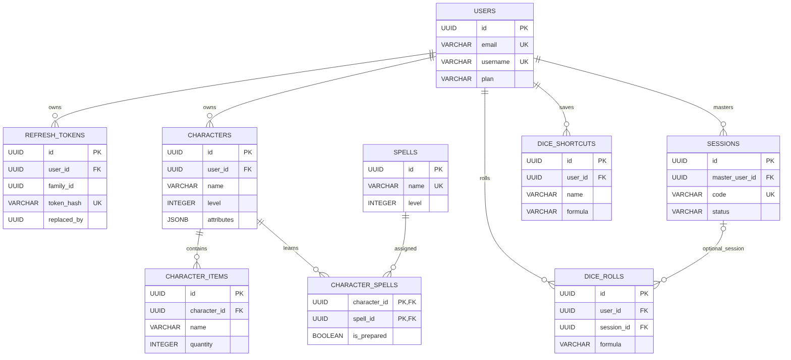
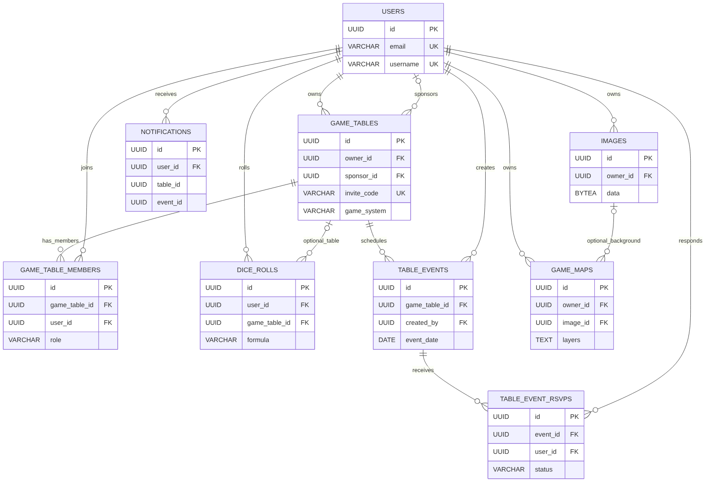

# Modelo de dados — RollCore

> **Versão documentada em 25/11/2026.** Fonte da verdade: as migrações PostgreSQL/Flyway V1 a V20 em `backend/src/main/resources/db/migration/` (no pacote de entrega, `api/src/main/resources/db/migration/`). O documento descreve o esquema declarado pelas migrações, não garante que uma instância de banco específica já tenha aplicado todas elas.

## Visão geral

- **SGBD previsto:** PostgreSQL 16.
- **Tabelas:** 16.
- **Migrações examinadas:** V1–V20.
- **Diagrama ER editável:** visão geral em [`diagrams/DADOS_ER.mmd`](diagrams/DADOS_ER.mmd) (Mermaid), com recortes legíveis em `DADOS_ER_NUCLEO.mmd` e `DADOS_ER_MESAS.mmd` na mesma pasta.
- **Regra para defaults:** “—” significa que não há `DEFAULT` declarado na migração; `NULL` significa coluna anulável sem default declarado.
- **Timestamps:** `TIMESTAMP` nas migrações equivale a `TIMESTAMP WITHOUT TIME ZONE` no PostgreSQL.

## Diagrama entidade-relacionamento

Para leitura no PDF, o modelo completo é apresentado em dois recortes complementares. O arquivo `diagrams/DADOS_ER.mmd` contém a visão geral integral editável, e `diagrams/DADOS_ER.png` é sua renderização. Os arquivos `.mmd` podem ser abertos em qualquer editor Mermaid, e o GitHub também os exibe como diagrama.

### Núcleo: contas, personagens, magias e rolagens

### Mesas, eventos, notificações e mapas

Os diagramas mostram apenas relações com FK declarada. Campos UUID que parecem identificadores de outras tabelas, mas que **não** possuem FK — como `refresh_tokens.replaced_by`, `notifications.table_id` e `notifications.event_id` — não são desenhados como relações.

## Dicionário de dados

### 1. `users` — contas e identidade

| Coluna | Tipo | Nulo? | Default | Chave/restrição e significado |
|---|---|---:|---|---|
| `id` | UUID | Não | `gen_random_uuid()` | PK; identificador da conta. |
| `email` | VARCHAR(255) | Não | — | Único; e-mail de login. |
| `username` | VARCHAR(20) | Não | — | Único; nome de usuário. |
| `password_hash` | VARCHAR(255) | Não | — | Hash de senha; obrigatório também para contas com Google, conforme V9. |
| `created_at` | TIMESTAMP | Não | `now()` | Criação do registro. |
| `updated_at` | TIMESTAMP | Não | `now()` | Atualização; trigger `trg_users_updated_at` redefine para `now()` antes de UPDATE. |
| `plan` | VARCHAR(10) | Não | `'FREE'` | CHECK: `FREE` ou `PREMIUM`; não implica cobrança implementada. |
| `google_sub` | VARCHAR(64) | Sim | `NULL` | Identificador Google opcional; UNIQUE quando informado. |
| `avatar_url` | TEXT | Sim | `NULL` | URL HTTPS ou data URL de avatar, conforme comentário da migração. |

**Índices/constraints:** PK `id`; UNIQUE `email`, `username`, `google_sub`; índice `idx_users_email(email)`; CHECK `ck_users_plan`.

### 2. `refresh_tokens` — refresh tokens rotativos

| Coluna | Tipo | Nulo? | Default | Chave/restrição e significado |
|---|---|---:|---|---|
| `id` | UUID | Não | `gen_random_uuid()` | PK do registro. |
| `user_id` | UUID | Não | — | FK para `users.id`, ON DELETE CASCADE. |
| `family_id` | UUID | Não | — | Identifica a família/cadeia de rotação; sem FK declarada. |
| `token_hash` | VARCHAR(64) | Não | — | Hash do token; UNIQUE. A migração diz que o token em texto claro não é armazenado. |
| `expires_at` | TIMESTAMP | Não | — | Expiração. |
| `revoked_at` | TIMESTAMP | Sim | `NULL` | Momento de revogação, quando aplicável. |
| `replaced_by` | UUID | Sim | `NULL` | Identificador do token substituto; **sem FK declarada**. |
| `created_at` | TIMESTAMP | Não | `now()` | Criação do registro. |

**Índices/constraints:** PK `id`; UNIQUE `token_hash`; índices `idx_refresh_tokens_user(user_id)`, `idx_refresh_tokens_family(family_id)`, `idx_refresh_tokens_expires(expires_at)`.

### 3. `characters` — fichas de personagem

| Coluna | Tipo | Nulo? | Default | Chave/restrição e significado |
|---|---|---:|---|---|
| `id` | UUID | Não | `gen_random_uuid()` | PK. |
| `user_id` | UUID | Não | — | FK para `users.id`, ON DELETE CASCADE. |
| `name` | VARCHAR(100) | Não | — | Nome do personagem. |
| `class` | VARCHAR(50) | Não | — | Classe. |
| `subclass` | VARCHAR(100) | Não | `''` | Subclasse. |
| `race` | VARCHAR(50) | Não | — | Raça. |
| `level` | INTEGER | Não | — | Nível; tipo final INTEGER após V2; CHECK 1–20. |
| `attributes` | JSONB | Não | `'{}'` | Atributos estruturados em JSONB. |
| `hp` | INT | Não | `0` | Pontos de vida atuais. |
| `max_hp` | INT | Não | `0` | Pontos de vida máximos. |
| `temp_hp` | INT | Não | `0` | Pontos de vida temporários. |
| `ac` | INT | Não | `10` | Classe de armadura. |
| `spell_slots` | JSONB | Sim | `NULL` | Espaços de magia. |
| `warlock_slots` | JSONB | Sim | `NULL` | Espaços de Magia de Pacto. |
| `created_at` | TIMESTAMP | Não | `now()` | Criação. |
| `updated_at` | TIMESTAMP | Não | `now()` | Atualização automática pelo trigger `trg_characters_updated_at`. |
| `game_system` | VARCHAR(50) | Não | `'D&D 5e'` | Sistema de RPG associado; texto livre. |
| `coins_pp` | INT | Não | `0` | Moedas de platina. |
| `coins_gp` | INT | Não | `0` | Moedas de ouro. |
| `coins_sp` | INT | Não | `0` | Moedas de prata. |
| `coins_cp` | INT | Não | `0` | Moedas de cobre. |
| `avatar_url` | TEXT | Sim | `NULL` | URL HTTPS ou data URL do retrato. |

**Índices/constraints:** PK `id`; FK `user_id`; CHECK do nível; `idx_characters_user_id(user_id)`; índice GIN `idx_characters_attributes(attributes)`; trigger de `updated_at`.

### 4. `character_items` — itens de inventário

| Coluna | Tipo | Nulo? | Default | Chave/restrição e significado |
|---|---|---:|---|---|
| `id` | UUID | Não | — | PK; UUID fornecido pelo cliente/aplicação. |
| `character_id` | UUID | Não | — | FK para `characters.id`, ON DELETE CASCADE. |
| `name` | VARCHAR(80) | Não | — | Nome do item. |
| `category` | VARCHAR(12) | Não | `'other'` | CHECK: `weapon`, `armor`, `consumable`, `other`. |
| `quantity` | INT | Não | `1` | CHECK 0–9999. |
| `weight` | NUMERIC(7,2) | Não | `0` | Peso por unidade, kg segundo comentário da migração; CHECK ≥ 0. |
| `damage` | VARCHAR(40) | Sim | `NULL` | Dano, se aplicável. |
| `description` | VARCHAR(500) | Sim | `NULL` | Descrição opcional. |
| `created_at` | TIMESTAMP | Não | `now()` | Criação. |

**Índices/constraints:** PK `id`; FK `character_id`; CHECKs de categoria, quantidade e peso; índice `idx_character_items_character(character_id, created_at)`.

### 5. `spells` — catálogo de magias

| Coluna | Tipo | Nulo? | Default | Chave/restrição e significado |
|---|---|---:|---|---|
| `id` | UUID | Não | `gen_random_uuid()` | PK. |
| `name` | VARCHAR(150) | Não | — | Nome; UNIQUE. |
| `level` | INTEGER | Não | — | Nível final INTEGER após V5; CHECK 0–9. |
| `school` | VARCHAR(30) | Não | — | Escola. |
| `casting_time` | VARCHAR(80) | Não | — | Tempo de conjuração. |
| `range` | VARCHAR(80) | Não | — | Alcance. |
| `components` | VARCHAR(120) | Não | — | Componentes. |
| `duration` | VARCHAR(80) | Não | — | Duração. |
| `description` | TEXT | Não | — | Descrição. |
| `higher_levels` | TEXT | Sim | `NULL` | Efeito em níveis superiores. |
| `classes` | TEXT[] | Não | — | Classes associadas; array de texto. |
| `ritual` | BOOLEAN | Não | `FALSE` | Indica ritual. |
| `concentration` | BOOLEAN | Não | `FALSE` | Indica concentração. |
| `attack_type` | VARCHAR(20) | Sim | `NULL` | Tipo de ataque, quando aplicável. |
| `damage_dice` | VARCHAR(20) | Sim | `NULL` | Expressão de dano. |
| `damage_type` | VARCHAR(30) | Sim | `NULL` | Tipo de dano. |
| `save_attribute` | VARCHAR(3) | Sim | `NULL` | Atributo de resistência. |
| `source` | VARCHAR(60) | Não | `'Livro do Jogador'` | Fonte indicada para a magia. |

**Índices/constraints:** PK `id`; UNIQUE `name`; CHECK de `level`; índice `idx_spells_level(level)`; GIN `idx_spells_classes(classes)`; GIN `idx_spells_name_fts` sobre `to_tsvector('portuguese', name)`.

### 6. `character_spells` — associação ficha–magia

| Coluna | Tipo | Nulo? | Default | Chave/restrição e significado |
|---|---|---:|---|---|
| `character_id` | UUID | Não | — | Parte da PK composta; FK para `characters.id`, ON DELETE CASCADE. |
| `spell_id` | UUID | Não | — | Parte da PK composta; FK para `spells.id`, ON DELETE CASCADE. |
| `is_prepared` | BOOLEAN | Não | `TRUE` | Indica preparada. |
| `position` | SMALLINT | Não | `0` | Posição na lista. |
| `added_at` | TIMESTAMP | Não | `now()` | Data de associação. |

**Índices/constraints:** PK composta `(character_id, spell_id)`; índice `idx_cs_character_id(character_id)`. Relaciona `characters` e `spells` em muitos-para-muitos.

### 7. `sessions` — scaffold de sessão ao vivo

| Coluna | Tipo | Nulo? | Default | Chave/restrição e significado |
|---|---|---:|---|---|
| `id` | UUID | Não | `gen_random_uuid()` | PK. |
| `code` | VARCHAR(10) | Não | — | Código; UNIQUE. |
| `master_user_id` | UUID | Não | — | FK para `users.id`, ON DELETE CASCADE. |
| `name` | VARCHAR(100) | Não | — | Nome da sessão. |
| `status` | VARCHAR(20) | Não | `'ACTIVE'` | CHECK: `ACTIVE` ou `CLOSED`. |
| `created_at` | TIMESTAMP | Não | `now()` | Criação. |

**Índices/constraints:** PK `id`; UNIQUE `code`; índices `idx_sessions_code(code)` e `idx_sessions_master(master_user_id)`. **Não há FK para `game_tables`**: V1 descreve `sessions` como scaffold separado e V7 diferencia mesa persistente de sessão ao vivo.

### 8. `dice_rolls` — histórico de rolagens

| Coluna | Tipo | Nulo? | Default | Chave/restrição e significado |
|---|---|---:|---|---|
| `id` | UUID | Não | `gen_random_uuid()` | PK. |
| `user_id` | UUID | Não | — | FK para `users.id`, ON DELETE CASCADE. |
| `session_id` | UUID | Sim | `NULL` | FK para `sessions.id`, ON DELETE SET NULL. |
| `formula` | VARCHAR(50) | Não | — | Fórmula da rolagem. |
| `individual_results` | JSONB | Não | `'[]'` | Resultados individuais mantidos como JSONB. |
| `total` | INT | Não | — | Total. |
| `rolled_at` | TIMESTAMP | Não | `now()` | Momento da rolagem. |
| `game_table_id` | UUID | Sim | `NULL` | FK para `game_tables.id`, ON DELETE CASCADE. |
| `label` | VARCHAR(80) | Sim | `NULL` | Rótulo opcional. |
| `mode` | VARCHAR(12) | Não | `'normal'` | CHECK: `normal`, `advantage`, `disadvantage`. |
| `discarded_results` | JSONB | Sim | `NULL` | Resultados descartados em vantagem/desvantagem. |

**Índices/constraints:** PK `id`; índices `idx_dice_rolls_user(user_id)`, `idx_dice_rolls_rolled_at(rolled_at DESC)`, `idx_dice_rolls_game_table(game_table_id, rolled_at DESC)`, `idx_dice_rolls_user_table(user_id, game_table_id, rolled_at DESC)`; CHECK `chk_dice_rolls_mode`.

### 9. `dice_shortcuts` — atalhos de rolagem

| Coluna | Tipo | Nulo? | Default | Chave/restrição e significado |
|---|---|---:|---|---|
| `id` | UUID | Não | — | PK; sem default declarado. |
| `user_id` | UUID | Não | — | FK para `users.id`, ON DELETE CASCADE. |
| `name` | VARCHAR(40) | Não | — | Nome do atalho. |
| `formula` | VARCHAR(50) | Não | — | Fórmula salva. |
| `created_at` | TIMESTAMP | Não | `now()` | Criação. |

**Índices/constraints:** PK `id`; índice `idx_dice_shortcuts_user(user_id, created_at)`.

### 10. `game_tables` — mesas persistentes

| Coluna | Tipo | Nulo? | Default | Chave/restrição e significado |
|---|---|---:|---|---|
| `id` | UUID | Não | `gen_random_uuid()` | PK. |
| `owner_id` | UUID | Não | — | FK para `users.id`, ON DELETE CASCADE. |
| `name` | VARCHAR(100) | Não | — | Nome da mesa. |
| `game_system` | VARCHAR(50) | Não | `'D&D 5e'` | Sistema de RPG, texto livre. |
| `description` | VARCHAR(2000) | Sim | `NULL` | Descrição. |
| `max_players` | INT | Não | `5` | CHECK 1–20. |
| `cover_url` | VARCHAR(500) | Sim | `NULL` | URL da capa. |
| `invite_code` | VARCHAR(10) | Não | — | Código de convite; UNIQUE. |
| `created_at` | TIMESTAMP | Não | `now()` | Criação. |
| `updated_at` | TIMESTAMP | Não | `now()` | Atualização via trigger `trg_game_tables_updated_at`. |
| `sponsor_id` | UUID | Sim | `NULL` na definição | FK para `users.id`, ON DELETE SET NULL; V8 preenche inicialmente com `owner_id`. |

**Índices/constraints:** PK `id`; UNIQUE `invite_code`; CHECK de `max_players`; índices `idx_game_tables_owner(owner_id)` e `idx_game_tables_sponsor(sponsor_id)`; duas FKs para `users` (proprietário e patrocinador).

### 11. `game_table_members` — membros de mesas

| Coluna | Tipo | Nulo? | Default | Chave/restrição e significado |
|---|---|---:|---|---|
| `id` | UUID | Não | — | PK; sem default declarado. |
| `game_table_id` | UUID | Não | — | FK para `game_tables.id`, ON DELETE CASCADE. |
| `user_id` | UUID | Não | — | FK para `users.id`, ON DELETE CASCADE. |
| `role` | VARCHAR(20) | Não | — | CHECK: `MASTER`, `MODERATOR`, `PLAYER`. |
| `display_name` | VARCHAR(50) | Sim | `NULL` | Nome de exibição opcional. |
| `avatar_url` | VARCHAR(500) | Sim | `NULL` | URL de avatar opcional. |
| `muted` | BOOLEAN | Não | `FALSE` | Estado de silenciamento. |
| `joined_at` | TIMESTAMP | Não | `now()` | Entrada na mesa. |

**Índices/constraints:** PK `id`; UNIQUE `(game_table_id, user_id)`; índices/FKs `idx_gtm_user(user_id)`, mesa e usuário.

### 12. `table_events` — eventos do calendário

| Coluna | Tipo | Nulo? | Default | Chave/restrição e significado |
|---|---|---:|---|---|
| `id` | UUID | Não | `gen_random_uuid()` | PK. |
| `game_table_id` | UUID | Não | — | FK para `game_tables.id`, ON DELETE CASCADE. |
| `created_by` | UUID | Não | — | FK para `users.id`, ON DELETE CASCADE. |
| `title` | VARCHAR(100) | Não | — | Título. |
| `description` | VARCHAR(2000) | Sim | `NULL` | Descrição. |
| `event_date` | DATE | Não | — | Data do evento. |
| `start_time` | TIME | Não | — | Hora inicial local, sem fuso horário. |
| `end_time` | TIME | Não | — | Hora final; CHECK `end_time > start_time`. |
| `repeat_rule` | VARCHAR(20) | Não | `'NONE'` | CHECK: `NONE`, `WEEKLY`, `BIWEEKLY`, `MONTHLY`. |
| `color` | VARCHAR(20) | Não | `'BLUE'` | CHECK: `RED`, `BLUE`, `GREEN`, `AMBER`, `TEAL`, `PURPLE`. |
| `ask_rsvp` | BOOLEAN | Não | `TRUE` | Se solicita confirmação. |
| `created_at` | TIMESTAMP | Não | `now()` | Criação. |

**Índices/constraints:** PK `id`; FKs de mesa e usuário; checks de horário, repetição e cor; índice `idx_table_events_table_date(game_table_id, event_date)`.

### 13. `table_event_rsvps` — confirmações de presença

| Coluna | Tipo | Nulo? | Default | Chave/restrição e significado |
|---|---|---:|---|---|
| `id` | UUID | Não | `gen_random_uuid()` | PK. |
| `event_id` | UUID | Não | — | FK para `table_events.id`, ON DELETE CASCADE. |
| `user_id` | UUID | Não | — | FK para `users.id`, ON DELETE CASCADE. |
| `status` | VARCHAR(10) | Não | — | CHECK: `YES`, `MAYBE`, `NO`. |
| `responded_at` | TIMESTAMP | Não | `now()` | Momento da resposta. |

**Índices/constraints:** PK `id`; UNIQUE `(event_id, user_id)`; FKs de evento e usuário; CHECK de status.

### 14. `images` — imagens armazenadas

| Coluna | Tipo | Nulo? | Default | Chave/restrição e significado |
|---|---|---:|---|---|
| `id` | UUID | Não | `gen_random_uuid()` | PK. |
| `owner_id` | UUID | Não | — | FK para `users.id`, ON DELETE CASCADE. |
| `content_type` | VARCHAR(30) | Não | — | CHECK: `image/jpeg`, `image/png`, `image/webp`. |
| `size_bytes` | INT | Não | — | Tamanho informado em bytes; sem CHECK declarado na migração. |
| `data` | BYTEA | Não | — | Conteúdo binário da imagem. |
| `created_at` | TIMESTAMP | Não | `now()` | Criação. |

**Índices/constraints:** PK `id`; FK `owner_id`; CHECK de `content_type`; índice `idx_images_owner(owner_id)`.

### 15. `notifications` — notificações in-app

| Coluna | Tipo | Nulo? | Default | Chave/restrição e significado |
|---|---|---:|---|---|
| `id` | UUID | Não | `gen_random_uuid()` | PK. |
| `user_id` | UUID | Não | — | FK para `users.id`, ON DELETE CASCADE; destinatário. |
| `type` | VARCHAR(30) | Não | — | CHECK: `MEMBER_JOINED`, `MEMBER_LEFT`, `ROLE_CHANGED`, `REMOVED_FROM_TABLE`, `HOST_TRANSFERRED`, `TABLE_DELETED`, `EVENT_CREATED`. |
| `table_id` | UUID | Sim | `NULL` | Snapshot/identificador de mesa; **sem FK intencionalmente**. |
| `table_name` | VARCHAR(100) | Sim | `NULL` | Snapshot do nome da mesa. |
| `actor_name` | VARCHAR(50) | Sim | `NULL` | Snapshot do ator. |
| `detail` | VARCHAR(200) | Sim | `NULL` | Detalhe. |
| `read_at` | TIMESTAMP | Sim | `NULL` | Momento da leitura; NULL indica não lida. |
| `created_at` | TIMESTAMP | Não | `now()` | Criação. |
| `event_id` | UUID | Sim | `NULL` | Identificador para abrir evento; V19 adiciona a coluna **sem FK**. |

**Índices/constraints:** PK `id`; FK `user_id`; CHECK de `type`; índices `idx_notifications_user_created(user_id, created_at DESC)` e parcial `idx_notifications_user_unread(user_id) WHERE read_at IS NULL`.

### 16. `game_maps` — mapas de batalha

| Coluna | Tipo | Nulo? | Default | Chave/restrição e significado |
|---|---|---:|---|---|
| `id` | UUID | Não | `gen_random_uuid()` | PK. |
| `owner_id` | UUID | Não | — | FK para `users.id`, ON DELETE CASCADE. |
| `name` | VARCHAR(100) | Não | — | Nome. |
| `kind` | VARCHAR(20) | Não | — | CHECK: `MEDIEVAL`, `STEAMPUNK`, `CYBERPUNK`, `WESTERN`, `PIRATE`, `MODERN`. |
| `grid_type` | VARCHAR(10) | Não | — | CHECK: `SQUARE` ou `HEX`. |
| `grid_cols` | INT | Não | — | CHECK 5–100. |
| `grid_rows` | INT | Não | — | CHECK 5–100. |
| `cell_size` | INT | Não | — | CHECK 16–128 pixels. |
| `image_id` | UUID | Sim | `NULL` | FK para `images.id`, ON DELETE SET NULL. |
| `layers` | TEXT | Não | `'{}'` | Documento textual com camadas. A migração não declara tipo JSON/JSONB. |
| `grid_visible` | BOOLEAN | Não | `TRUE` | Visibilidade da grade. |
| `fog_enabled` | BOOLEAN | Não | `FALSE` | Ativação da névoa de guerra. |
| `published` | BOOLEAN | Não | `FALSE` | Publicação. |
| `published_at` | TIMESTAMP | Sim | `NULL` | Data de publicação. |
| `created_at` | TIMESTAMP | Não | `now()` | Criação. |
| `updated_at` | TIMESTAMP | Não | `now()` | Atualização. |

**Índices/constraints:** PK `id`; FKs de `owner_id` e `image_id`; CHECKs de tema, grade e dimensões; `idx_game_maps_owner(owner_id, updated_at DESC)`, parcial `idx_game_maps_image(image_id) WHERE image_id IS NOT NULL`, parcial `idx_game_maps_published(published_at DESC) WHERE published`.

## Relações e regras referenciais

| Relação | Cardinalidade | Regra de exclusão |
|---|---|---|
| `users` → `characters` | 1:N | Excluir usuário exclui fichas. |
| `characters` → `character_items` | 1:N | Excluir ficha exclui itens. |
| `characters` ↔ `spells` por `character_spells` | N:N | Excluir ficha ou magia remove associações. |
| `users` → `refresh_tokens` | 1:N | Excluir usuário exclui tokens. |
| `users` → `sessions` | 1:N como mestre | Excluir mestre exclui sessões. |
| `users` → `dice_rolls` | 1:N | Excluir usuário exclui rolagens. |
| `sessions` → `dice_rolls` | 1:N opcional na rolagem | Excluir sessão define `dice_rolls.session_id` como NULL. |
| `game_tables` → `dice_rolls` | 1:N opcional na rolagem | Excluir mesa exclui rolagens da mesa. |
| `users` → `game_tables` | 1:N como proprietário e, separadamente, patrocinador | Exclusão do proprietário exclui a mesa; exclusão do patrocinador define `sponsor_id` como NULL. |
| `game_tables` ↔ `users` por `game_table_members` | N:N | Excluir mesa ou usuário remove associação. |
| `game_tables` → `table_events` | 1:N | Excluir mesa exclui eventos. |
| `table_events` ↔ `users` por `table_event_rsvps` | N:N | Excluir evento ou usuário remove RSVP. |
| `users` → `table_events` | 1:N como criador | Excluir usuário criador exclui eventos criados. |
| `users` → `dice_shortcuts`, `images`, `notifications`, `game_maps` | 1:N | Em cada caso a FK declara ON DELETE CASCADE. |
| `images` → `game_maps` | 1:N opcional no mapa | Excluir imagem define `game_maps.image_id` como NULL. |

## Observações de interpretação

1. `sessions` (V1) e `game_tables` (V7) são entidades distintas. `dice_rolls` pode referenciar opcionalmente ambas, por FKs independentes; o esquema não declara que uma sessão ao vivo pertence a uma mesa.
2. IDs que lembram referências (`refresh_tokens.replaced_by`, `notifications.table_id` e `notifications.event_id`) não possuem FK nas migrações. A ausência é intencional para permitir que esses registros sobrevivam à exclusão de entidades associadas, conforme comentários de V6, V18 e V19.
3. `character_spells` é uma tabela associativa com PK composta. `table_event_rsvps` e `game_table_members` usam PK UUID própria e UNIQUE composto para impedir duplicidade da associação.
4. `characters.level` e `spells.level` são apresentados com os tipos finais após as migrações corretivas V2 e V5: INTEGER.
5. `V4__seed_spells.sql` insere dados do catálogo; não cria tabela adicional.

## Referências de esquema

Migrações `V1__init_schema.sql` a `V20__maps.sql` em `backend/src/main/resources/db/migration/`. Para detalhes de comportamento da aplicação, consultar as entidades e serviços do backend; as descrições acima limitam-se ao que é definido ou comentado nas migrações.
